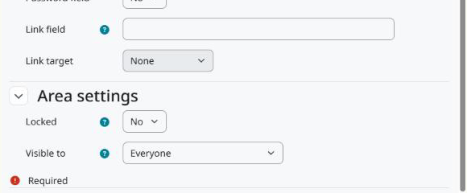

Configuration
=============

Go to *Site administration > Badges > Badge custom fields*. The fields apply to every badge, site and course badges alike.

The page works like the course custom fields page: add a category to group the fields, then add the fields and choose their type.

   The area settings at the end of the field form.

Area settings
-------------

Locked
   Only users with ``tool/badgecustomfields:changelockedcustomfields`` can edit the value.

Visible to
   * *Everyone*: users who can manage the badges of the context, and everyone else for badges available to earn, on the badge pages and through the web service.
   * *Users who can edit the values*: only users with ``tool/badgecustomfields:edit`` in the context of the badge.
   * *Nobody*: the value is not shown and not returned by the web service. Users who can edit the values still see it on the editing page.

Capabilities
------------

``tool/badgecustomfields:configurecustomfields`` (system)
   Manage the fields. Manager by default.

``tool/badgecustomfields:edit`` (course)
   Edit the values of the badges in that context: site badges in the system context, course badges in their course. Manager and editing teacher by default, and copied from ``moodle/badges:configuredetails`` on install.

``tool/badgecustomfields:changelockedcustomfields`` (course)
   Edit locked fields. Manager by default.
