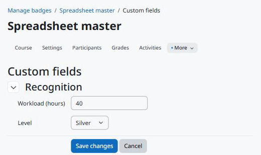

Usage
=====

Editing the values
------------------

The values and an *Edit custom fields* button appear below the badge name on these pages, for users who can edit the values:

* the badge overview page (*Manage badges*, then the badge);
* the badge details form (*Edit details* in the badge menu).

The button opens the common editing page of the Moodle Fields Suite. Save to go back to the badge overview.

   Editing the values of a badge.

Users who cannot edit see only the values visible to them; when there are none, nothing is shown. Archived badges do not show their values.

Web service
-----------

``local_fieldssuite_get_values`` with ``component=tool_badgecustomfields``, ``area=badge`` and the ``instanceids`` returns, for each badge the user can see, the fields the user can see. Users who cannot manage badges see only the badges available to earn.

.. code-block:: bash

   curl "https://moodle.example/webservice/rest/server.php?wstoken=TOKEN&moodlewsrestformat=json&wsfunction=local_fieldssuite_get_values&component=tool_badgecustomfields&area=badge&instanceids[0]=12"

Deleting and archiving
----------------------

* Deleting a badge deletes its values. The fields stay.
* Archiving a badge keeps its values, which are no longer shown.
* Deleting a course archives its badges and turns them into site badges; their values move to the system context with them.
* Duplicating a badge does not copy its values.
