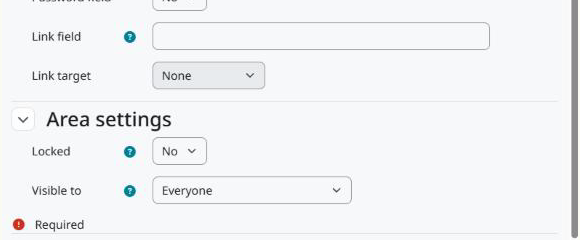

Configuração
============

Acesse *Administração do site > Emblemas > Badge custom fields*. Os campos valem para todos os emblemas, do site e de curso.

A página funciona como a dos campos personalizados do curso: crie uma categoria para agrupar os campos, depois os campos e o tipo de cada um.

   As configurações da área no fim do formulário do campo.

Configurações da área
---------------------

Bloqueado
   Só usuários com ``tool/badgecustomfields:changelockedcustomfields`` podem editar o valor.

Visível para
   * *Todos*: quem pode gerenciar os emblemas do contexto e, nos emblemas disponíveis para conquista, todos os demais, nas páginas do emblema e pelo web service.
   * *Usuários que podem editar os valores*: só usuários com ``tool/badgecustomfields:edit`` no contexto do emblema.
   * *Ninguém*: o valor não aparece nem é devolvido pelo web service. Quem pode editar os valores continua vendo-o na página de edição.

Permissões
----------

``tool/badgecustomfields:configurecustomfields`` (sistema)
   Gerenciar os campos. Gerente, por padrão.

``tool/badgecustomfields:edit`` (curso)
   Editar os valores dos emblemas naquele contexto: emblemas do site no contexto do sistema, emblemas de curso no curso. Gerente e professor, por padrão, e copiada de ``moodle/badges:configuredetails`` na instalação.

``tool/badgecustomfields:changelockedcustomfields`` (curso)
   Editar campos bloqueados. Gerente, por padrão.
