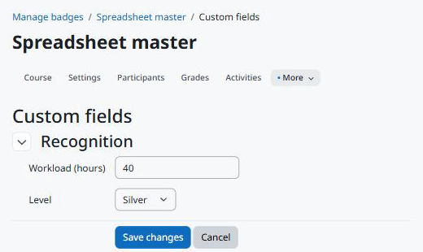

Uso
===

Editando os valores
-------------------

Os valores e um botão *Edit custom fields* aparecem abaixo do nome do emblema nestas páginas, para quem pode editar os valores:

* a visão geral do emblema (*Gerenciar emblemas* e depois o emblema);
* o formulário de detalhes do emblema (*Editar detalhes* no menu do emblema).

O botão abre a página comum de edição da Moodle Fields Suite. Ao salvar, você volta à visão geral do emblema.

   Editando os valores de um emblema.

Quem não pode editar vê só os valores visíveis para si; quando não há nenhum, nada aparece. Emblemas arquivados não mostram os valores.

Web service
-----------

``local_fieldssuite_get_values`` com ``component=tool_badgecustomfields``, ``area=badge`` e os ``instanceids`` devolve, para cada emblema que o usuário pode ver, os campos que ele pode ver. Quem não pode gerenciar emblemas vê só os emblemas disponíveis para conquista.

.. code-block:: bash

   curl "https://moodle.exemplo/webservice/rest/server.php?wstoken=TOKEN&moodlewsrestformat=json&wsfunction=local_fieldssuite_get_values&component=tool_badgecustomfields&area=badge&instanceids[0]=12"

Excluindo e arquivando
----------------------

* Excluir um emblema exclui os valores dele. Os campos continuam.
* Arquivar um emblema mantém os valores, que deixam de aparecer.
* Excluir um curso arquiva os emblemas dele e os transforma em emblemas do site; os valores vão junto para o contexto do sistema.
* Duplicar um emblema não copia os valores.
